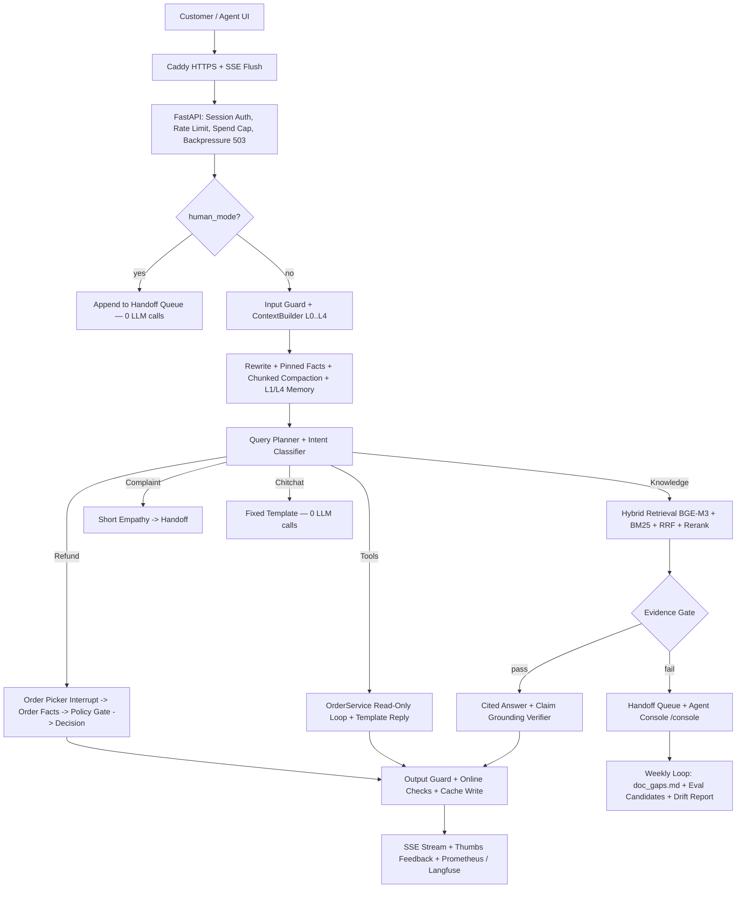

# Atlas (`support-agent`) — Production-Grade After-Sales Support Agent

An English e-commerce after-sales customer-service agent built with LangGraph, Milvus hybrid retrieval (BGE-M3 dense + BM25 + RRF + cross-encoder reranker), a calibrated evidence gate, claim-level grounding, prefix-cacheable context engineering, governed customer memory, and a human handoff console. It answers with verified citations, handles order and refund flows with read-only tools, and **fails closed to a human whenever evidence or safety checks fail**.

- **Live Demo (self-hosted HTTPS stack)**: see [`docs/DEPLOY.md`](docs/DEPLOY.md) (`docker-compose.prod.yml` + Caddy HTTPS + daily spend cap)
- **Demo Video**: [2-minute walkthrough](https://example.com/VIDEO-LINK-TO-BE-ADDED) (placeholder)


## What "Production-Grade" Means Here

Every production claim maps directly to an implemented mechanism and a reproducible report:

| Concern | Mechanism | Evidence |
|---|---|---|
| **Safety & Grounding** | Evidence gate (4 signals), store-scope filter, model-number veto, claim-level quote verification, input/output guardrails, signed Bearer sessions | [`e2e.md`](eval/reports/e2e.md), [`claim_grounding.md`](eval/reports/claim_grounding.md), [`redteam.md`](eval/reports/redteam.md), [`docs/THREAT_MODEL.md`](docs/THREAT_MODEL.md) |
| **Reliability** | Per-call timeouts, bounded retries, model fallback & structured repair, circuit breakers, fail-closed handoffs, idempotent refund keys, conversation leases | [`chaos.md`](eval/reports/chaos.md), [`docs/RELIABILITY.md`](docs/RELIABILITY.md) |
| **Data Lifecycle** | Versioned Milvus index registry, incremental section re-embedding, protected alias release & instant rollback, time-sensitive policy metadata filters | [`index_lifecycle.md`](eval/reports/index_lifecycle.md), [`policy_versions.md`](eval/reports/policy_versions.md) |
| **Context & Memory** | Single `ContextBuilder` (`L0_global`..`L4_turn`), pinned facts, append-only chunked compaction, governed long-term memory (write policy, TTL, Postgres RLS, `/api/me/memories`) | [`context_ab.md`](eval/reports/context_ab.md), [`memory_short.md`](eval/reports/memory_short.md), [`memory_long.md`](eval/reports/memory_long.md), [`docs/CONTEXT.md`](docs/CONTEXT.md), [`docs/MEMORY.md`](docs/MEMORY.md) |
| **Evaluation Stack** | Frozen splits, bootstrap/Wilson CIs, CI release gate, red-team v2, multi-turn simulator, online feedback, stratified near-threshold review, PSI/KS drift monitoring | [`docs/EVAL_PLATFORM.md`](docs/EVAL_PLATFORM.md), [`sim.md`](eval/reports/sim.md), [`drift.md`](eval/reports/drift.md), [`docs/ONLINE_EVAL.md`](docs/ONLINE_EVAL.md) |
| **Performance & Capacity** | Three-layer versioned caching, Locust load suite + mock LLM, `cProfile`-backed allowlist cache, bounded `max_in_flight` backpressure (`503` + `Retry-After`) | [`cache.md`](eval/reports/cache.md), [`load.md`](eval/reports/load.md), [`docs/SLO.md`](docs/SLO.md) |
| **Human Loop & Ops** | Atomic handoff queue, checkpointed `human_mode` (zero LLM calls), `/console` UI + live SSE replies, weekly doc-gap & candidate loop, eval-gated release workflow, runbook | [`docs/HANDOFF.md`](docs/HANDOFF.md), [`docs/DEPLOY.md`](docs/DEPLOY.md), [`docs/RELEASE.md`](docs/RELEASE.md), [`docs/RUNBOOK.md`](docs/RUNBOOK.md) |

## Results at a Glance

All numbers below are generated by `make results` from `eval/reports/`. No percentage is hand-typed outside this block (enforced by CI).

<!-- RESULTS:START -->
<!-- Generated by `make results` from eval/reports/. Do not edit by hand. -->

| Metric | Value | Eval set | Source |
|---|---:|---|---|
| No-answer false accept (full graph) | 0.00% | test | [`e2e.md`](eval/reports/e2e.md) |
| Answerable false reject (full graph) | 21.67% | test | [`e2e.md`](eval/reports/e2e.md) |
| Accepted outcomes | 62.67% (94/150) | test | [`e2e.md`](eval/reports/e2e.md) |
| Retrieval Recall@5 (hybrid + rerank) | 1.0000 | test, answerable | [`retrieval.md`](eval/reports/retrieval.md) |
| Retrieval MRR@5 (hybrid + rerank) | 0.9938 | test, answerable | [`retrieval.md`](eval/reports/retrieval.md) |
| Recall@5 inside the full graph | 0.9083 | test | [`e2e.md`](eval/reports/e2e.md) |
| Citation validity (gold-section overlap) | 0.7104 | test | [`e2e.md`](eval/reports/e2e.md) |
| Intent accuracy | 0.8619 | intent holdout (420) | [`intent.md`](eval/reports/intent.md) |
| Hallucination, judge-flagged | 5.33% (kappa: n/a (0/30 labels)) | test | [`hallucination_review.md`](eval/reports/hallucination_review.md) |
| Hallucination, human-confirmed | pending | test | [`hallucination_review.md`](eval/reports/hallucination_review.md) |
| Latency P50 / P95 (full answer) | 16.1277s / 28.1733s | test | [`e2e.md`](eval/reports/e2e.md) |
| Cost per conversation | price not set (7290 tokens, 2.07 LLM calls, mean) | test | [`e2e.md`](eval/reports/e2e.md) |

**Retrieval modes** (test split, answerable questions only):

| Mode | Recall@5 | MRR@5 | Mean latency (s) |
|---|---:|---:|---:|
| Dense only (BGE-M3) | 0.9667 | 0.9125 | 3.1413 |
| BM25 only | 0.9875 | 0.9028 | 0.4806 |
| Hybrid (dense + BM25, RRF) | 0.9917 | 0.9458 | 3.6229 |
| Hybrid + rerank (shipped) | 1.0000 | 0.9938 | 10.2582 |
| Hybrid, heading prefix off | 0.9792 | 0.9299 | 3.8068 |
| Hybrid, model-number normaliser off | 0.9917 | 0.9458 | 3.6066 |

**Evidence gate alone** (no LLM), threshold `0.15` picked on dev ([`threshold_sweep.md`](eval/reports/threshold_sweep.md)):

| Split | False accept | False reject |
|---|---:|---:|
| dev (tuning) | 0.00% | 0.00% |
| test (reported once) | 3.33% | 1.67% |

**Report runs.** Each report records its own run:

| Report | Git SHA | Date (UTC) |
|---|---|---|
| [`e2e.md`](eval/reports/e2e.md) | `266c1e8` | 2026-11-17 |
| [`retrieval.md`](eval/reports/retrieval.md) | `bed2ad5` | 2026-11-22 |
| [`intent.md`](eval/reports/intent.md) | `94eac69` | 2026-11-28 |
| [`hallucination_review.md`](eval/reports/hallucination_review.md) | `9ed1d57` | 2026-11-10 |
| [`threshold_sweep.md`](eval/reports/threshold_sweep.md) | `9d9ee8e` | 2026-11-14 |

The hallucination review audits an earlier test run (2026-11-10) than the full-graph report (2026-11-17).

**Phase 2 production metrics** (measured in live & capacity evals; drift is a simulated week):

| Area | Metric | Measured value | Source |
|---|---|---:|---|
| Security | Red-team v2 overall ASR | 0/73 · 0.00% [0.00%, 5.00%] | [`redteam.md`](eval/reports/redteam.md) |
| Security | Benign look-alike false blocks | 0/15 · 0.00% [0.00%, 20.39%] | [`redteam.md`](eval/reports/redteam.md) |
| Context / Cache | Prefix-cache hit ratio, `chunked` (units/conv vs full-price counterfactual) | 84.1% (1374.9 vs 5764.0 units) | [`context_ab.md`](eval/reports/context_ab.md) |
| Long-term Memory | Cross-session fact use in the reply (ON; OFF 1/10) | 1/10 (10.0%, 95% CI [1.8%, 40.4%]) | [`memory_long.md`](eval/reports/memory_long.md) |
| Long-term Memory | Cross-customer canary leaks | 0/6 (0.0%, 95% CI [0.0%, 39.0%]) | [`memory_long.md`](eval/reports/memory_long.md) |
| Load / Capacity | Throughput before -> after fix (mock LLM, conc=16) | 66.2 -> 77.1 req/s (160/160 (100.00%)) | [`load.md`](eval/reports/load.md) |
| Load / Capacity | Overall P50 / P95 / P99 before -> after | 229.7 / 346.5 / 404.8 -> 205.6 / 293.6 / 315.7 ms | [`load.md`](eval/reports/load.md) |
| Online Drift (simulated) | Day-5 missing-doc shift breaches caught | 8/8 | [`drift.md`](eval/reports/drift.md) |
<!-- RESULTS:END -->

## v1 vs v2 Comparison

| Capability | v1 (Commits 01–16) | v2 Production-Grade (Commits 17–35) |
|---|---|---|
| State & Checkpoints | Local SQLite + in-memory checkpoints | PostgreSQL + Alembic migrations + Redis locks/cache + Postgres checkpointer |
| Safety & Security | Evidence gate + coverage check | + Claim-level grounding, input/output guardrails, PII redaction, signed Bearer auth, red-team v2 CI gate |
| Retrieval & KB | Static full Milvus re-ingest | + Versioned index registry, incremental updates, alias rollback, policy effective-date filters, multipart query planning |
| Context & Memory | Ad-hoc message lists per node | + Prefix-stable `ContextBuilder`, pinned facts, chunked compaction, governed long-term memory with Postgres RLS |
| Human Handoff | One-way handoff message | + Atomic queue, zero-LLM `human_mode`, `/console` live SSE replies, labelled doc-gap & eval candidate loop |
| Operations & Monitoring | Optional Langfuse tracing | + Prometheus `/metrics`, chaos tests, online feedback & PSI/KS drift alerts, Locust load tests, SLOs, spend cap, eval-gated release |

## Architecture v2



## Design Decisions and Trade-Offs

1. **Fixed workflow graph, not an autonomous free agent**: Retrieval and the evidence gate are fixed LangGraph edges so the LLM can never skip them; trade-off is that classifier misroutes cannot self-recover downstream.
2. **Fail-closed over availability**: When Milvus, the reranker, or structured verification fails, knowledge and refund paths hand off instead of answering with weaker evidence.
3. **Claim removal vs full rewrite**: Claim grounding drops unsupported sentences or hands off the affected part rather than asking an LLM to rewrite freely, keeping latency bounded and preventing new hallucinations.
4. **Partial answers on multipart questions**: Independent per-part gating lets Atlas answer supported halves with citations while handing off only the unsupported half.
5. **Versioned cache eligibility**: Only single-turn, grounded, passed-gate knowledge answers are cached under `(build_id, prompt_version, model, filters)`; near-duplicate semantic caching stays off by default after contrast-pair testing.
6. **Prefix-stable context & memory as hints**: `L0_global` and turn-1 `L1_session` stay frozen across turns for provider prefix caching; mid-turn memory lookups go into `L4_turn`, and memories never satisfy the evidence gate or appear in citations.

## Quickstart (Local)

```bash
cp .env.example .env          # set LLM_PROVIDER, LLM_FAST_MODEL, LLM_MAIN_MODEL, and provider API key
make setup                    # uv sync + pre-commit install
make up                       # start Milvus (plus Postgres/Redis with `make up-state`)
make data                     # download datasets + license report + policy docs + mock orders
make ingest                   # chunk + embed + load into Milvus
make serve                    # start FastAPI on http://127.0.0.1:8000 (chat at /, console at /console)
make check                    # ruff + mypy + pytest + interview notes check
```

## Honest Limitations

- **Synthetic data & simulated online traffic**: Orders, customers (`example.com`), red-team sets, and the 7-day drift replay (`eval/reports/drift.md`) are synthetic/simulated — never presented as live production customer traffic.
- **Pending human reviews**: Several draft label sets (eval_v1 human review, hallucination judge calibration, long-term memory junk-rate CSV, and handoff console resolutions) are exported for human labelling rather than self-labelled by the agent.
- **Single-region, single-VM demo**: `docker-compose.prod.yml` targets one VM with Caddy HTTPS and demo Bearer tokens, not multi-region autoscaling or enterprise SSO.
- **TTFT buffered by output safety**: `output_guard` checks the complete draft before streaming SSE tokens, trading lower TTFT for guaranteed output-guard coverage.
