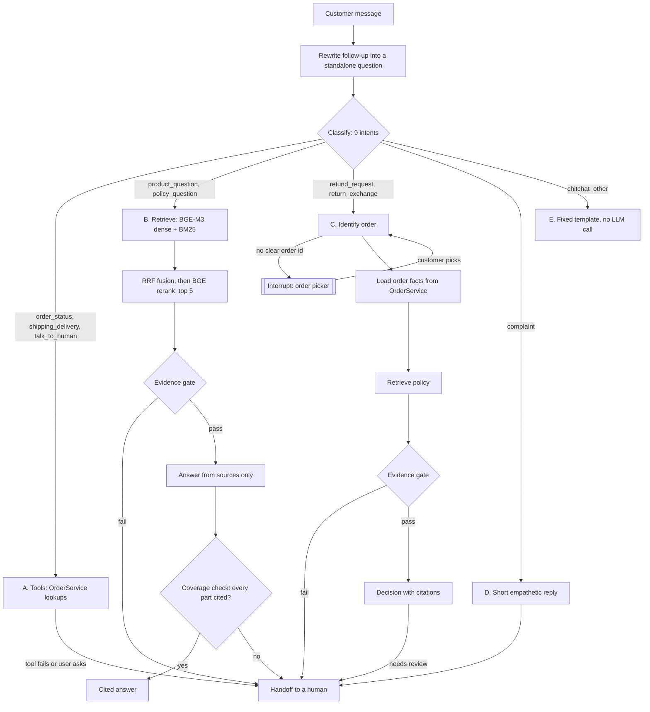

# support-agent

An English after-sales support agent for an online shop.
It answers policy and product questions with citations, looks up orders with tools,
and hands off to a human when the evidence is weak. It does not guess.


Demo video: [2-minute walkthrough](https://example.com/VIDEO-LINK-TO-BE-ADDED) (placeholder, link coming).

## Results at a glance

All numbers below are generated by `make results` from the reports in `eval/reports/`.
"False accept" means the agent answered a question the sources cannot answer.
"False reject" means it handed off a question the sources can answer.
The labels are drafts that a human has not reviewed yet.

<!-- RESULTS:START -->
<!-- Generated by `make results` from eval/reports/. Do not edit by hand. -->

| Metric | Value | Eval set | Source |
|---|---:|---|---|
| No-answer false accept (full graph) | 0.00% | test | [`e2e.md`](eval/reports/e2e.md) |
| Answerable false reject (full graph) | 21.67% | test | [`e2e.md`](eval/reports/e2e.md) |
| Accepted outcomes | 62.67% (94/150) | test | [`e2e.md`](eval/reports/e2e.md) |
| Retrieval Recall@5 (hybrid + rerank) | 1.0000 | test, answerable | [`retrieval.md`](eval/reports/retrieval.md) |
| Retrieval MRR@5 (hybrid + rerank) | 0.9938 | test, answerable | [`retrieval.md`](eval/reports/retrieval.md) |
| Recall@5 inside the full graph | 0.9083 | test | [`e2e.md`](eval/reports/e2e.md) |
| Citation validity (gold-section overlap) | 0.7104 | test | [`e2e.md`](eval/reports/e2e.md) |
| Intent accuracy | 0.9048 | intent holdout (420) | [`intent.md`](eval/reports/intent.md) |
| Hallucination, judge-flagged | 5.33% (kappa: n/a (0/30 labels)) | test | [`hallucination_review.md`](eval/reports/hallucination_review.md) |
| Hallucination, human-confirmed | pending | test | [`hallucination_review.md`](eval/reports/hallucination_review.md) |
| Latency P50 / P95 (full answer) | 16.1277s / 28.1733s | test | [`e2e.md`](eval/reports/e2e.md) |
| Cost per conversation | price not set (7290 tokens, 2.07 LLM calls, mean) | test | [`e2e.md`](eval/reports/e2e.md) |

**Retrieval modes** (test split, answerable questions only):

| Mode | Recall@5 | MRR@5 | Mean latency (s) |
|---|---:|---:|---:|
| Dense only (BGE-M3) | 0.9667 | 0.9125 | 3.1413 |
| BM25 only | 0.9875 | 0.9028 | 0.4806 |
| Hybrid (dense + BM25, RRF) | 0.9917 | 0.9458 | 3.6229 |
| Hybrid + rerank (shipped) | 1.0000 | 0.9938 | 10.2582 |
| Hybrid, heading prefix off | 0.9792 | 0.9299 | 3.8068 |
| Hybrid, model-number normaliser off | 0.9917 | 0.9458 | 3.6066 |

**Evidence gate alone** (no LLM), threshold `0.15` picked on dev ([`threshold_sweep.md`](eval/reports/threshold_sweep.md)):

| Split | False accept | False reject |
|---|---:|---:|
| dev (tuning) | 0.00% | 0.00% |
| test (reported once) | 3.33% | 1.67% |

**Report runs.** Each report records its own run:

| Report | Git SHA | Date (UTC) |
|---|---|---|
| [`e2e.md`](eval/reports/e2e.md) | `266c1e8` | 2026-11-17 |
| [`retrieval.md`](eval/reports/retrieval.md) | `bed2ad5` | 2026-11-22 |
| [`intent.md`](eval/reports/intent.md) | `fbbbfd3` | 2026-11-10 |
| [`hallucination_review.md`](eval/reports/hallucination_review.md) | `9ed1d57` | 2026-11-10 |
| [`threshold_sweep.md`](eval/reports/threshold_sweep.md) | `9d9ee8e` | 2026-11-14 |

The hallucination review audits an earlier test run (2026-11-10) than the full-graph report (2026-11-17).
<!-- RESULTS:END -->

## Architecture

Every turn takes fixed steps: rewrite the question, classify it, then follow one of five paths.
The model never decides whether to retrieve. Retrieval and the evidence gate are fixed edges.



The API streams each turn over Server-Sent Events. The chat page is one static HTML file.
Details: [`docs/INTENTS.md`](docs/INTENTS.md), [`docs/RETRIEVAL.md`](docs/RETRIEVAL.md),
[`docs/REFUND_FLOW.md`](docs/REFUND_FLOW.md), [`docs/TOOL_PATHS.md`](docs/TOOL_PATHS.md).

## Design decisions and trade-offs

**1. A fixed workflow, not a free agent.**
- Decision: LangGraph with fixed edges. Small tool loops run only inside the tools path, with a step cap.
- Why: retrieval and the gate can never be skipped. Each route is a node sequence I can test.
- Evidence: the intent accuracy row above; graph tests assert the route, not only the text.
- Cost: a wrong label sends the question down the wrong path, and nothing recovers it later.
  The failure list in [`e2e.md`](eval/reports/e2e.md) shows these routing losses.

**2. Hybrid retrieval with RRF and a reranker, not one retriever.**
- Decision: dense (BGE-M3) and BM25 each return their top 50. RRF merges them by rank. A cross-encoder keeps the top 5.
- Why: dense search misses exact model numbers. BM25 misses paraphrases. Together they cover both.
- Evidence: the retrieval modes table above and [`retrieval.md`](eval/reports/retrieval.md).
- Cost: the reranker is the slowest step (see the latency column), and I host two models.

**3. The evidence gate runs before the answer model.**
- Decision: four signals (top rerank score, count of good chunks, top-1 margin, key-term hits) give one score.
  Below the threshold, the agent hands off. The answer model never sees weak evidence.
- Why: a model that sees weak evidence tends to guess. A handoff is cheaper than a wrong answer.
- Evidence: compare the gate-alone rows with the full-graph rows above.
  The gate alone is not enough, so a coverage check after the answer hands off any part without a citation.
- Cost: more false rejects. Customers wait for a human more often.

**4. The threshold comes from a dev sweep, then test is reported once.**
- Decision: `make sweep` scores every dev question and picks the threshold in the gap above the
  highest no-answer score. Test is run once with that value and reported unchanged.
- Why: picking the threshold on test would make the test number meaningless.
- Evidence: [`threshold_sweep.md`](eval/reports/threshold_sweep.md) and its chart.
- Cost: the price of safety is false rejects. A higher threshold would lose more answerable questions.

**5. A dev/test split, with failures kept.**
- Decision: 300 questions in five groups, split evenly into dev and test. Weights and prompts are tuned on dev only.
- Why: I need one set to tune on and one to trust.
- Evidence: [`eval_set.md`](eval/reports/eval_set.md). The first full test run failed the safety target.
  It is frozen unchanged in [`baselines/e2e-001`](eval/reports/baselines/e2e-001/e2e.md).
- Cost: after many rounds, the test set is no longer fresh. I built new no-answer holdouts for later fixes
  ([`holdout_near_miss.md`](eval/reports/holdout_near_miss.md)).

**6. In refunds, facts come from tools and rules come from retrieval.**
- Decision: order status, dates and items come only from `OrderService`. The refund rule comes only from cited policy.
- Why: the model must never invent an order fact or a policy.
- Evidence: [`docs/REFUND_FLOW.md`](docs/REFUND_FLOW.md) and `tests/test_refund_flow.py`.
- Cost: strict code checks send some correct decisions to a human. Retrieval and decisions are measured in
  [`refund_policy.md`](eval/reports/refund_policy.md) and [`refund_decisions.md`](eval/reports/refund_decisions.md).

## Quick start

Prerequisites:
- Python 3.11 and [uv](https://docs.astral.sh/uv/)
- Docker with Compose, for Milvus (a vector database)
- An API key for one chat model that `langchain` supports (for example DeepSeek, OpenAI or Anthropic)
- About 5 GB of free disk for the two BGE models, plus the Docker images

```bash
git clone https://github.com/WongAnneLister/Atlas.git
cd Atlas
cp .env.example .env   # fill in LLM_PROVIDER, LLM_FAST_MODEL, LLM_MAIN_MODEL and the provider key
make setup             # install dependencies with uv
make check             # lint, types and offline tests; no network, models or LLM calls
make up                # start Milvus in Docker
make data              # download the datasets, check licenses, build policy docs, seed mock orders
make eval-build        # prepare the registered evaluation set
make eval-smoke-build  # materialize the frozen release smoke set
make ingest            # build a Milvus collection and check it before releasing
make serve             # chat page at http://127.0.0.1:8000
```

Expect `make data` to take a few minutes. It also rewrites the run metadata (dates, hashes) in a few generated docs.
The first `make ingest` downloads the embedding model and reranker, then checks the new index.
An existing deployment can adopt its current index before building a new one.
See [Index lifecycle](docs/RETRIEVAL.md#index-lifecycle).

`make serve` reads `.env` itself. Pick a demo customer in the page, then ask a question.
Tick **Debug** to see the gate score and the node trace.
The demo has no login and trusts the customer id you pick.

## Reproduce the numbers

The eval questions are built locally, because two sources may not be shared (see below).
Each report records the eval file hash, so you can check you built the same set.

```bash
set -a; source .env; set +a   # eval targets read the process environment
make eval-build               # build the 300-question set
make eval-retrieval           # 4 retrieval modes + 2 ablations -> eval/reports/retrieval.md
make sweep                    # gate threshold on dev, test once -> eval/reports/threshold_sweep.md
make eval-e2e                 # full graph on test -> eval/reports/e2e.md
make eval-judge               # model-flagged hallucinations -> eval/reports/hallucination_review.md
make eval-intent-build        # build the intent holdout
make eval-intent              # intent accuracy -> eval/reports/intent.md
make results                  # refresh the table in this README
```

Each report lists its git SHA, config hash, model names, dataset versions, split and date.
More runs and their history: [`docs/RESULTS.md`](docs/RESULTS.md) and [`docs/PROGRESS.md`](docs/PROGRESS.md).
Tracing and cost by intent: [`docs/OBSERVABILITY.md`](docs/OBSERVABILITY.md).

## Data and licenses

| Dataset | Used for | License verdict |
|---|---|---|
| [NebulaByte/E-Commerce_FAQs](https://huggingface.co/datasets/NebulaByte/E-Commerce_FAQs) | Flipkart store policy FAQs | unclear: scripts only |
| [InfiniFlow/Ecommerce-Customer-Service-Workflow](https://huggingface.co/datasets/InfiniFlow/Ecommerce-Customer-Service-Workflow) | Philips product manuals and leaflets | unclear: scripts only |
| [MakTek/Customer_support_faqs_dataset](https://huggingface.co/datasets/MakTek/Customer_support_faqs_dataset) | Generic store FAQs | apache-2.0: may share |
| [bitext/Bitext-customer-support-llm-chatbot-training-dataset](https://huggingface.co/datasets/bitext/Bitext-customer-support-llm-chatbot-training-dataset) | Intent examples and colloquial phrasing | cdla-sharing-1.0: may share |

The first two cards say apache-2.0, but the text was copied from Flipkart and Philips pages.
So this repo ships download scripts, not their text. Reasons: [`docs/LICENSES.md`](docs/LICENSES.md).

What is synthetic:
- All orders, customers and prices. They come from a fixed seed, with `example.com` emails ([`docs/ORDERS.md`](docs/ORDERS.md)).
- The cross-document and no-answer eval questions, written from templates.
- The near-miss holdouts and store controls, written by an AI agent.

## Limitations and next steps

- **Refund decisions are checked on a small set only.** Fourteen named orders and a small rule-based
  holdout ([`refund_decisions.md`](eval/reports/refund_decisions.md)). The model still denies some orders
  the policy would allow (a paid order not yet shipped). Code blocks approvals outside the return window.
- **Harder no-answer questions still slip through sometimes.** The near-miss holdouts show a few false accepts
  ([`store_scope.md`](eval/reports/store_scope.md), [`tools_fallback.md`](eval/reports/tools_fallback.md)).
- **The labels are drafts.** No human has reviewed the 300 questions or confirmed the judge's hallucination flags.
- **Run-to-run noise.** The same model at temperature 0 gives different outcomes between runs.
  Single-run differences of a few items are noise. Confidence intervals come in the next phase.
- **The classifier sometimes fails.** The model returns no structured label, and the turn gets the fixed fallback reply.
- **Small and synthetic.** English only, two stores, seven products, mock orders.
- **No security layer.** No login, no rate limits, no prompt-injection tests yet.
- **Not done from the plan:** model prices (cost shows "price not set"), long conversation memory,
  query decomposition for cross-document questions, and a red-team set. The production phase covers these.

## Project layout

```
configs/default.yaml        every threshold, weight, top-k and model name
src/support_agent/
  data/                     download, license check, policy-doc builder
  orders/                   SQLite schema, seed generator, OrderService
  retrieval/                chunking, embedding, Milvus store, hybrid + RRF, rerank
  gate/                     evidence gate
  graph/                    LangGraph state, intents, nodes, prompts
  api/                      FastAPI SSE endpoint and the static chat page
  observability/            optional Langfuse tracing, token and cost counting
eval/                       eval scripts; reports/ holds the generated reports
scripts/                    helper CLIs, including render_results.py
tests/                      offline unit tests (integration tests are marked)
docs/                       design notes, progress log, demo script, interview notes
```

Work log: [`docs/PROGRESS.md`](docs/PROGRESS.md). Demo script: [`docs/DEMO_SCRIPT.md`](docs/DEMO_SCRIPT.md).
