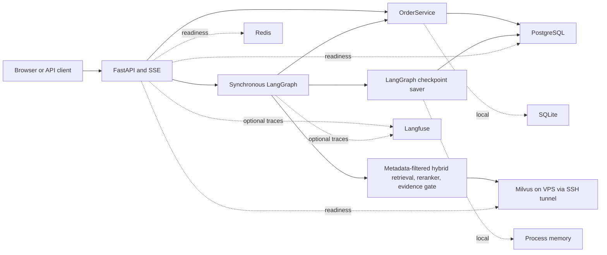

# Atlas platform architecture

A chat request uses the customer and conversation IDs to identify a checkpoint thread.
FastAPI streams updates from the synchronous graph through a worker thread. When
the refund path interrupts for order selection, synchronous checkpoint writes
save the state before the API returns the picker. A new API process can look up
that thread and continue it when the client posts the selected order to
`/api/resume`. The refund path looks up the order again and evaluates retrieved
policy before recording a pending request. The persisted user message ID makes
replaying that write return the same request.

Knowledge requests search policies in force on the configured current date. A
recognized product category limits the catalog candidates and policy candidates
remain eligible. The refund path searches by the purchase date read from
OrderService. Both dense and lexical searches use the same date criteria before
fusion and reranking. Handoff snapshots record the requested filters and whether
the index applied them.

## State ownership

| State | Owner | Reason |
|---|---|---|
| Customers, orders, shipments, pending refund requests and seed metadata | OrderService using PostgreSQL or local SQLite | Constraints and transactions keep linked rows consistent. |
| Messages, graph progress and pending order selection | LangGraph saver in PostgreSQL, process memory or explicitly configured SQLite | A shared saver lets another process resume after an interrupt. |
| Knowledge chunks and search indexes | Milvus | Dense and lexical retrieval use the same indexed corpus. |
| Redis keys | Redis in dev and prod, in-memory store available locally | Expiring keys support later platform features. This commit uses Redis for readiness. |
| Trace events | Optional Langfuse | Diagnostic traces can be collected outside the request state stores. |
| Active turn locks | FastAPI process | They coordinate concurrent requests within one worker until commit 19. |

## Environment selection

`ENV` selects a YAML overlay over `configs/default.yaml` or the base selected by
`SUPPORT_AGENT_CONFIG`. Nested keys are merged. Lists and scalar values are replaced.
Environment variables supply the state service URLs. The table shows the defaults.

| ENV | Orders | Checkpoint | Key-value backend |
|---|---|---|---|
| unset or `local` | SQLite | Memory | `NullRedis` |
| `dev` | PostgreSQL | PostgreSQL | Redis |
| `prod` | PostgreSQL | PostgreSQL | Redis |

The local setup can start with only LLM configuration. For dev and prod, configure
`DATABASE_URL` and `REDIS_URL` in the environment. Use the loopback Compose
endpoints in `.env.example` for local development. The Atlas Postgres host port
defaults to 5433. `make up-state` starts only PostgreSQL and Redis when the Milvus
tunnel is in use. `make up` also starts the local Milvus stack.

## Storage choices and operations

SQLAlchemy Core shares table definitions and bound queries between the two
databases. OrderService already maps results to Pydantic models, so Core lets
the same models represent orders throughout the application. The API runs
synchronous graph steps in a worker thread. Synchronous SQLAlchemy and
`PostgresSaver` fit that execution model and allow the graph nodes to keep
their existing interfaces.

Run `make migrate` before bringing up the dev or prod API. Alembic manages
order table revisions. The same target runs LangGraph's separate checkpoint
setup. Seed mock orders with `make data-orders` on the intended backend. The
reset and inserts run in one transaction. Migrations and seeding report the
target and reject databases with unexpected tables.

`/api/health/live` reports process liveness. `/api/health/ready` checks
PostgreSQL, the Alembic revision and checkpoint tables, Redis, and Milvus
concurrently with separate deadlines. It returns 503 when an enabled dependency
is down. The API starts without applying migrations. The legacy `/api/health`
route is also available.
