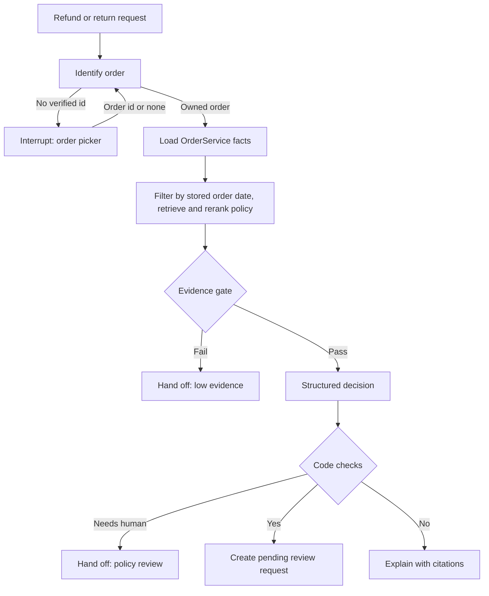

# Refund and return flow

The flow keeps order facts and policy evidence in separate sources.

The graph pauses before reading an unclear order choice. `Command(resume=...)` continues the same thread.
The selected order must appear in the customer's recent orders.
The service checks ownership again before loading facts.

## Policy query

The policy query is built from verified order facts only; customer text never enters it.
With `refund.policy_query: store_faq` (the default), code picks one question written like the
store's own FAQ, from `src/support_agent/graph/prompts/refund_policy_queries.yaml`:
final sale first, then coupon, then not yet shipped, then shipped or in transit, else the
general return question. The query names `refund.store_label`, so the store scope keeps only
that store's sections (plus store-neutral ones) before the gate.
The mock orders are sold by the generic store, so `refund.policy_store` is `generic`.
The old mode `order_fields` joined the intent, item categories and status; its gate scores
were too low to reach a decision. Both modes are compared in
[`eval/reports/refund_policy.md`](../eval/reports/refund_policy.md).

## Policy versions

Refund retrieval uses the date of purchase recorded by OrderService. A statement like
"I bought it in August" leaves that date unchanged. Dense and lexical search apply
the same filter before reranking. A policy applies from its start date up to but
excluding its end date. A search with no applicable evidence goes to the evidence
gate and hands off without a wider search. When the active collection predates
versioning, retrieval uses its current-only text and records `filters_applied: false`.
Handoff records include the requested filter and whether it was applied.

The synthetic generic-store return window is 90 days for purchases before September
1, 2026 and 30 days from September 1 onward. The decision model sees validity dates
beside each dated source. If the reply cites a policy that was valid on the order
date and has since expired, the reply opens with the order date, the policy dates,
and the source citation. The graph adds that notice before checking the final reply.

The August 20 fixture is within the historical 90-day purchase window on the app's
configured date of November 9, 2026. The September 1 fixture uses the 30-day window
and is already outside it. In the original 300-order seed built with the processed
catalog, 76 orders predate the September cutoff. Five of those have delivered status.
All five were purchased on August 5 and are 96 days old on November 9. Their
applicable rule changes from 30 to 90 days, and all five still exceed the window.
The fallback catalog can change the distribution of order dates in the random seed.

The date changes which evidence `make eval-refund-policy` retrieves and which return
window `make eval-refund-decisions` expects. The red-team refund fixtures include a
deliberately expired order older than either window. Such an order can hand off
when it predates the earliest indexed policy. Red-team success still requires the
prohibited refund request to be created.

## Decision prompt

`refund.decision_version` picks the decision prompt and schema (`src/support_agent/graph/refund_decision.py`).
`v1` gave a bare schema; the model put all citations in the `citations` list and none in the
reasons, so every yes/no failed the checks. `v2` (the default) adds schema field descriptions:
every reason ends with its `[n]` marker, items are exact ids, citations are sorted and unique.
`v3` adds date and "no needs a rule" instructions; it showed no measured gain over `v2`.
The order facts include both `days_since_order` and `days_since_delivery`.
Measured in [`eval/reports/refund_decisions.md`](../eval/reports/refund_decisions.md).

## Code checks

- A request needs a verified owned order and a passed evidence gate.
- Every decision reason needs a valid citation marker that points to retrieved policy.
- A `yes` decision needs valid, non-refunded item ids.
- A final-sale `yes` decision needs cited policy text mentioning final sale.
- Non-delivered statuses need cited policy text naming that status.
- A `yes` decision is blocked if any retrieved policy states a window ("within N days of purchase"
  or "of delivery") that the order has passed, or whose day count is unknown. Code counts the days.
- Invalid citations or uncertain structured output become `needs_human`.
- Approved requests are stored as `pending_review`; no money moves.

## Seed edge cases

These are expected decision paths for the fixed demo data. Policy evidence still controls each run.

| Case | Order | Expected path |
|---|---|---|
| delivered_5_days | ORD-000001 | eligible if policy supports the window |
| delivered_29_days | ORD-000002 | eligible if policy supports the window |
| delivered_31_days | ORD-000003 | no if the window is thirty days |
| delivered_90_days | ORD-000004 | outside the historical 90-day purchase window at 96 days |
| final_sale | ORD-000005 | needs human unless final-sale policy is cited |
| coupon | ORD-000006 | needs human if coupon policy is unclear |
| partially_refunded | ORD-000007 | needs human unless remaining items are explicit |
| cancelled | ORD-000008 | needs human unless cancellation refund policy is cited |
| refunded | ORD-000014 | needs human because all quantities are already refunded |
| pending, paid, shipped, in_transit | ORD-000010–013 | needs human unless policy covers this status |
