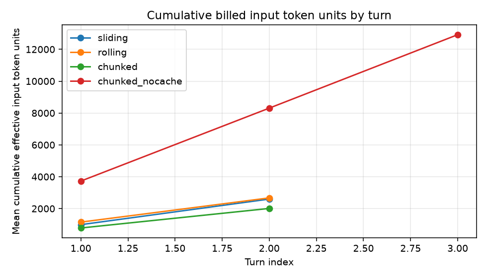

# Prefix-cache context strategy A/B report

Generated by `make eval-context-ab`. Do not edit by hand.

- Git SHA: `67616c191e9cabc0732f313240d5c7af772646b5`
- Config hash: `f5c5e2c54b52d95ad18bad683914140dd63e64ecbea7307196d099b58817c638`
- Test scenarios: 6 x 1 repeat(s) per arm
- Dev scenarios (chunk_turns sweep only): 3
- Agent models: fast=`deepseek-flash`, main=`deepseek-flash`
- Simulator model: `fast`
- Cache multipliers: read=`0.1`, write=`1.0` (USD prices unset in config, so billed cost is reported in effective input-token units)
- Date (UTC): 2026-11-23

## 1. Four-arm comparison (test split, 95% bootstrap CI)

| Arm | Task success | Fact retention | Redundant Q | Cache hit ratio | Prefix change rate | Mean hist tok | Eff. input units/conv | Latency P50/P95 (s) |
|---|---:|---:|---:|---:|---:|---:|---:|---:|
| `sliding` | 0.00% [0.00%, 0.00%] | n/a | 0.00 [0.00, 0.00] | 77.8% | 100.0% | 80.3 | 1941.5 | 9.61 / 16.22 |
| `rolling` | 16.67% [0.00%, 50.00%] | n/a | 0.00 [0.00, 0.00] | 68.9% | 100.0% | 55.7 | 1989.7 | 9.96 / 14.63 |
| `chunked` | 0.00% [0.00%, 0.00%] | n/a | 0.00 [0.00, 0.00] | 79.9% | 100.0% | 60.0 | 1300.1 | 4.29 / 14.53 |
| `chunked_nocache` | 0.00% [0.00%, 0.00%] | n/a | 0.00 [0.00, 0.00] | 0.0% | 100.0% | 144.1 | 6989.0 | 4.96 / 21.04 |

## 2. Cost decomposition (total tokens across all test runs)

| Arm | Total input | Uncached input | Cache reads | Cache writes | Output | Effective input units |
|---|---:|---:|---:|---:|---:|---:|
| `sliding` | 38836 | 8628 | 30208 | 0 | 2360 | 11648.8 |
| `rolling` | 31407 | 9775 | 21632 | 0 | 1807 | 11938.2 |
| `chunked` | 27730 | 5586 | 22144 | 0 | 1357 | 7800.4 |
| `chunked_nocache` | 41934 | 11214 | 30720 | 0 | 2267 | 41934.0 |

## 3. `chunk_turns` sensitivity sweep (dev split only)

| `chunk_turns` | Task success | Cache hit ratio | Eff. input units/conv | Mean hist tok |
|---:|---:|---:|---:|---:|
| 4 | 33.33% [0.00%, 100.00%] | 44.4% | 3514.6 | 39.4 |
| 6 | 33.33% [0.00%, 100.00%] | 51.3% | 3177.9 | 33.8 |
| 10 | 0.00% [0.00%, 0.00%] | 67.4% | 2312.8 | 26.4 |

## 4. Conclusion

- `chunked` vs `chunked_nocache` isolates caching savings: `1300.1` vs `6989.0` effective input units/conv.
- `chunked` had the lowest effective input units/conv across all four arms.

## 5. KV-level view (self-hosted vLLM)

- Status: skipped: no NVIDIA GPU detected on this host (`make bench-kv` skips cleanly without GPU).
