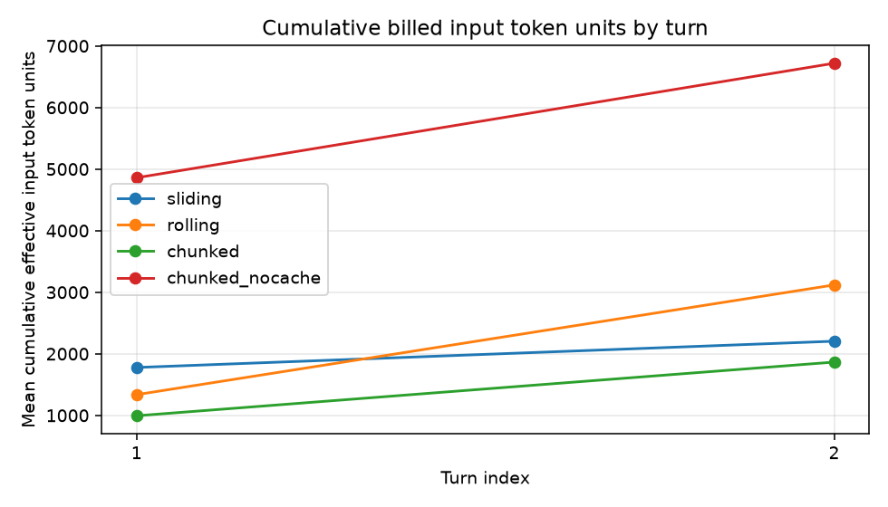

# Prefix-cache context strategy A/B report

Generated by `make eval-context-ab`. Do not edit by hand.

- Git SHA: `d3ee431d7efa96b9a3948dc66e794cd109a37bcc` (dirty: False)
- Config hash: `78ebaa91bf1e95674b696a1195bbd6dd2d074e5b73532cc9fe306590385320ca`
- Re-rendered without model calls from saved run `context-ab-20261126-13ce438c`
- Test scenarios: 6 x 1 repeat(s) per arm
- Dev scenarios (chunk_turns sweep only): 3
- Agent models: fast=`deepseek-flash`, main=`deepseek-flash`
- Simulator model: `fast`
- Cache multipliers: read=`0.1`, write=`1.0` (USD prices unset in config, so billed cost is reported in effective input-token units)
- Run date (UTC): 2026-11-26

## 1. Four-arm comparison (test split, 95% bootstrap CI)

| Arm | Task success | Fact retention | Redundant Q | Cache hit ratio | Stable prefix change rate | Mean hist tok | Eff. input units/conv | Latency P50/P95 (s) |
|---|---:|---:|---:|---:|---:|---:|---:|---:|
| `sliding` | 0.00% [0.00%, 0.00%] | n/a | 0.00 [0.00, 0.00] | 68.8% | 0.0% | 59.8 | 2258.8 | 4.94 / 14.31 |
| `rolling` | 16.67% [0.00%, 50.00%] | n/a | 0.00 [0.00, 0.00] | 68.7% | 0.0% | 71.6 | 2287.6 | 9.88 / 15.38 |
| `chunked` | 16.67% [0.00%, 50.00%] | n/a | 0.00 [0.00, 0.00] | 84.1% | 33.3% | 42.3 | 1374.9 | 5.95 / 14.37 |
| `chunked_nocache` | 16.67% [0.00%, 50.00%] | n/a | 0.00 [0.00, 0.00] | 83.6% | 33.3% | 43.7 | 5764.0 | 4.24 / 16.68 |

`chunked_nocache` sends no cache breakpoints, but the provider caches prompt
prefixes on its own, so its cache hit ratio is observed rather than zero. Its
effective units price every cache read at the full input rate: a counterfactual
for a provider without prefix caching, not a measured run without a cache.
The stable prefix change rate covers L0..L2 only. A sliding window that shifts
L3 history leaves it unchanged; that cost shows up in the cache hit ratio.

## 2. Cost decomposition (total tokens across all test runs)

| Arm | Total input | Uncached input | Cache reads | Cache writes | Output | Effective input units |
|---|---:|---:|---:|---:|---:|---:|
| `sliding` | 35556 | 11108 | 24448 | 0 | 2040 | 13552.8 |
| `rolling` | 35959 | 11255 | 24704 | 0 | 2263 | 13725.4 |
| `chunked` | 33939 | 5395 | 28544 | 0 | 1947 | 8249.4 |
| `chunked_nocache` | 34584 | 5656 | 28928 | 0 | 2001 | 34584.0 |

## 3. `chunk_turns` sensitivity sweep (dev split only)

| `chunk_turns` | Task success | Cache hit ratio | Eff. input units/conv | Mean hist tok |
|---:|---:|---:|---:|---:|
| 4 | 33.33% [0.00%, 100.00%] | 47.1% | 3282.5 | 23.0 |
| 6 | 33.33% [0.00%, 100.00%] | 68.9% | 2160.5 | 28.2 |
| 10 | 33.33% [0.00%, 100.00%] | 53.8% | 2985.8 | 36.2 |

## 4. Conclusion

- `chunked` cost `1374.9` effective input units/conv; priced at the full input rate (the `chunked_nocache` counterfactual) the same kind of run cost `5764.0`.
- `chunked` had the lowest effective input units/conv across all four arms.

## 5. KV-level view (self-hosted vLLM)

- Status: skipped: no NVIDIA GPU detected on this host (`make bench-kv` skips cleanly without GPU).
